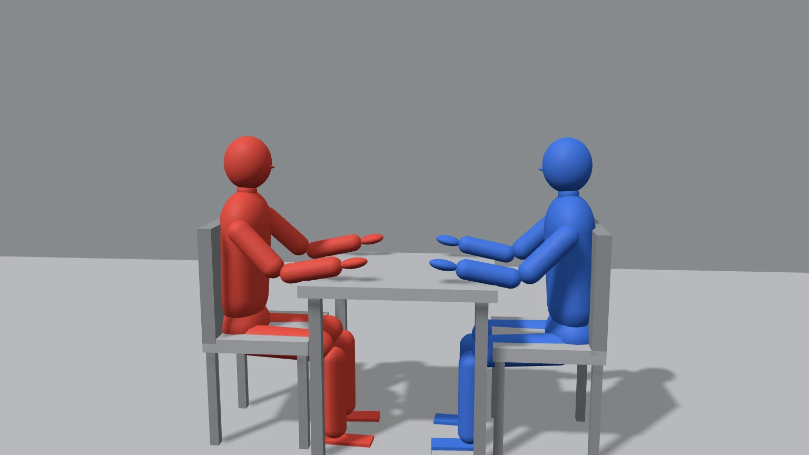
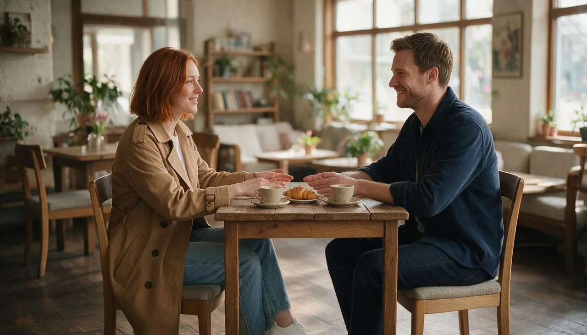
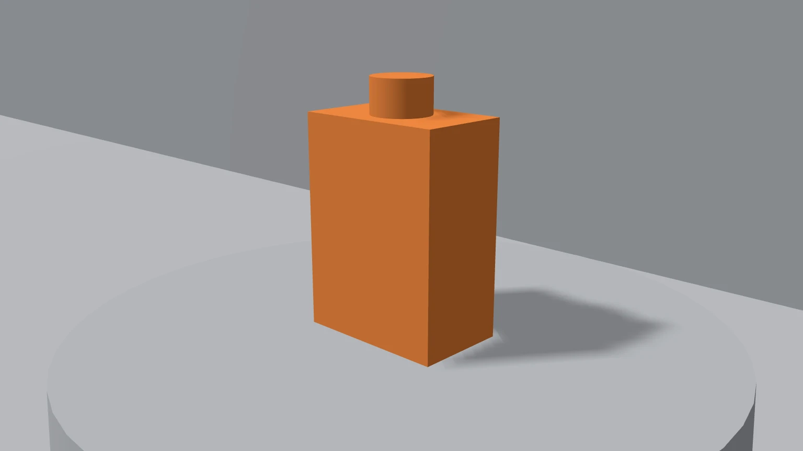

<p align="center">
  <a href="https://popnow.ai">
    <picture>
      <source media="(prefers-color-scheme: dark)" srcset="assets/popnow-wordmark-light.png">
      <source media="(prefers-color-scheme: light)" srcset="assets/popnow-wordmark.png">
      
    </picture>
  </a>
</p>

# PopNow for Blender — AI render, image & video generation add-on

**PopNow for Blender is a free Blender add-on that turns a clay blockout, a camera view or a camera animation into finished AI images, AI video and seamless textures, using models such as Seedream, Nano Banana, GPT Image, FLUX, Seedance, Wan and Kling through the [PopNow](https://popnow.ai) API.**

[](LICENSE)
[](https://www.blender.org/download/)
[](https://www.python.org/)
[](https://popnow.ai/blender)

Block out a scene with grey shapes, frame it with your camera, and PopNow paints it: a picture that keeps your composition, a short video that follows your camera move, or a tileable texture for the selected object. The add-on adds a **PopNow** tab to the 3D Viewport sidebar, uses your PopNow API key, and spends the same credits as [popnow.ai](https://popnow.ai). Make it pop.

| Clay render in | Finished frame out |
| --- | --- |
|  |  |
|  |  |

*Top: Seedream 5.0 Pro with two reference photos, 36 credits. Bottom: Nano Banana 2.1 with one product photo, 48 credits.*

## Quickstart

1. **Build the zip** (or download the ready-made one from [popnow.ai/blender](https://popnow.ai/blender)):

   ```bash
   git clone https://github.com/popnow-ai/popnow-blender.git
   cd popnow-blender
   python3 scripts/build_zip.py   # writes dist/popnow-blender-0.1.0.zip
   ```

2. **Install it in Blender 4.2 or newer.** Drag the zip into the Blender window, or open **Edit > Preferences > Get Extensions**, click the menu in the top right, choose **Install from Disk** and pick the zip. Allow online access when Blender asks; the add-on needs it to send renders and download results.

3. **Paste your API key.** Press **N** in the 3D Viewport, open the **PopNow** tab, click **Get API key**, create a key at [popnow.ai/api/console/keys](https://popnow.ai/api/console/keys) (it starts with `sk-popnow-`) and paste it. Your balance appears right away.

Now write what you want to see, pick a style and a model, and click the button that shows the price.

## Features

| Workflow | Input | Output |
| --- | --- | --- |
| **Render with AI** | The camera or viewport rendered as clean grey clay (or your last F12 render), an optional depth, normal or line-art pass, up to three reference photos | A finished image in the Image Editor; optionally set as the camera background or projected onto your meshes |
| **Animate with AI** | A quick Workbench preview of your camera animation | An MP4 that keeps your camera move, blocking and timing, ready to drop into the Video Sequencer |
| **Texture** | A description of a material and a style (photo scan, hand-painted, toon) | A square texture with blended edges and a box-projected material, applied to the selected objects |

- **Price first, then confirm.** The panel shows a live estimate; before anything starts, the add-on gets an exact quote from `jobs/quote` and asks you to confirm. Failed generations are refunded automatically.
- **Blender never freezes.** Uploads, polling and downloads run in a background thread; progress shows in the **Tasks** panel (also in the Image Editor sidebar).
- **Resume anything.** Closing Blender or pressing stop only stops waiting; started tasks finish on PopNow and can be resumed from the Tasks panel.
- **No extra Python packages, no GPU.** Generation runs on PopNow; your machine only renders a quick Workbench clay image (plus a one-sample Cycles pass for depth, normals or line art).
- **Scene settings are restored.** Camera, engine, resolution, color management, output path and frame range are put back exactly after each capture.

### Supported models

Prices are in credits (1 credit = $0.001), match popnow.ai, and are the lowest tier of each model. The live catalog is at `GET https://api.popnow.ai/api/v1/models`.

| Workflow | Model | Good for | From |
| --- | --- | --- | --- |
| Render | Seedream 5.0 Pro | Balanced; follows your layout closely | 36 credits per 1K image |
| Render | Seedream 5.0 Flash | Faster and cheaper | 29 credits |
| Render | Nano Banana 2.1 | Best with many reference images | 48 credits |
| Render | GPT Image 2 | Strong text and fine detail | 43 credits |
| Render | Qwen-Image 2.1 Turbo | Cheapest drafts | 15 credits |
| Render | FLUX.1 dev ControlNet | Exact shapes from a depth or line pass; no reference images | 36 credits |
| Animate | Seedance 2.0 Mini | Cheapest, good for drafts | 110 credits per 480p 5 s |
| Animate | Seedance 2.0 Fast | Balance of price and quality | 226 credits |
| Animate | Seedance 2.0 | Higher quality, up to 4K | 431 credits |
| Animate | Seedance 2.5 | Follows clay previz best | 738 credits |
| Animate | Wan 3.0 | Strong motion, up to 1080p | 450 credits |
| Animate | Kling O3 Restyle | Repaints your clip frame by frame, 3 to 10 s | 626 credits per 720p 5 s |
| Animate | Wan 2.2 Animate | Motion control: your character copies the clay figure | 265 credits |
| Texture | Seedream 5.0 Flash | Fast and cheap | 29 credits per 1K image |
| Texture | Qwen-Image 2.1 Turbo | Cheapest | 15 credits |
| Texture | Seedream 5.0 Pro | Most detail | 36 credits |
| Texture | Nano Banana 2.1 | Up to 4K | 48 credits |

## Usage

### Render with AI

1. Frame your shot with the scene camera, or switch the panel source to **Viewport**.
2. Write a prompt, pick a style (Photoreal, Cinematic, Product shot, Architecture, Stylized 3D, Anime, Concept art, Watercolor or None) and a model. Add up to three reference images for a character or product if you like.
3. Under **More**, choose the aspect ratio (or *Match camera*), resolution, and an optional **Structure** pass (Depth, Normals or Line art) that helps the model keep your shapes.
4. Click the price button, check the quote and click **Start**.
5. The result opens in the Image Editor and is saved in a `popnow` folder next to your `.blend` file. From the Tasks panel you can **Show** it, set it as **Camera bg**, **Project** it onto your meshes, **Save as…**, or run it **Again**.

### Animate with AI

Animate your camera (and blocking) as usual, then open **Animate with AI**. The add-on renders a short Workbench preview from the scene start frame, uploads it as the reference clip and asks the model to keep the camera move and timing. Pick the length and resolution under **More**. For Wan 2.2 Animate, pick a **Character** image: it copies the motion of the clay figure. The finished MP4 can go **To Video Editor**, become the **Camera bg**, or **Play** in your player.

### Texture

Describe a material (for example "mossy cobblestone"), pick a style and a model, and click the price button. The add-on makes the result seamless locally, saves a PNG and builds a material that uses UVs when the object has them and box projection when it does not. **Apply** assigns it to the selected objects.

### What leaves your computer

Only the rendered clay image or preview clip and the reference images you pick. Your `.blend` file, meshes and textures stay on your machine. Your API key is stored in Blender's user preferences, never inside a `.blend` file, so sharing a project never shares your key.

## Configuration

Open **Edit > Preferences > Add-ons > PopNow AI Render** (or the gear icon in the PopNow tab):

| Setting | Default | What it does |
| --- | --- | --- |
| API key | empty | Your `sk-popnow-...` key. When empty, the `POPNOW_API_KEY` environment variable is used |
| Save results to | empty | Folder for downloads. Empty: `popnow/` next to the saved `.blend`, or the add-on's user folder for unsaved files |
| Start without asking up to | 0 | Skip the confirm step when the quote is at most this many credits. 0 always asks |
| Show image results in an Image Editor | on | Open finished renders in an Image Editor (a new window if none is open) |
| API base URL | `https://api.popnow.ai/api/v1` | Change only for local testing |

Blender's **Preferences > System > Network > Allow Online Access** must be on; while it is off the add-on sends no requests.

## Error handling

| You see | Why | Fix |
| --- | --- | --- |
| The PopNow tab asks for a key | No key saved yet, or it was revoked | Create a key in the [API console](https://popnow.ai/api/console/keys) and paste it |
| The add-on cannot reach PopNow | **Allow Online Access** is off, or a firewall blocks `api.popnow.ai` | Turn it on in Preferences > System > Network |
| Not enough credits | The quote is higher than your balance | [Top up](https://popnow.ai/pricing), or pick a cheaper model, lower resolution or shorter clip |
| The video ignores the clay figures | The model follows prompts more than previz | Use Seedance 2.5, or Wan 2.2 Animate for a character |
| Shapes drift from your layout | Image models reinterpret outlines | Use FLUX.1 dev ControlNet with a depth or line-art pass |
| "Stop waiting" but the task keeps running | A started task runs to the end on PopNow | Resume later from the Tasks panel to download it |

Each task in the Tasks panel has a copy button for its task ID; include it when you contact [support](https://popnow.ai/contact).

## The API calls behind it

The add-on is an ordinary [PopNow API](https://popnow.ai/docs) client written with the Python standard library (`popnow/core/client.py`):

1. `POST /api/v1/common/upload-url` → `PUT` the bytes to the signed URL → `POST /api/v1/files/{fileId}/commit`, which returns a `popnow://f/...` URI.
2. `POST /api/v1/jobs/quote` for the exact price, then `POST /api/v1/jobs/createTask` with `quoteId`, `expectedCredits` and an `Idempotency-Key`.
3. Poll `GET /api/v1/jobs/recordInfo?taskId=...` until the task is `succeeded`, `failed` or `expired`, then download `output.assets[].url`.

If you script Blender yourself or run a render farm, you can make the same calls directly; see the [PopNow API reference](https://popnow.ai/docs/openapi) and [popnow-api](https://github.com/popnow-ai/popnow-api).

## Development

```text
popnow/                 the extension (this folder is what goes in the zip)
  blender_manifest.toml extension manifest (Blender 4.2+)
  core/                 no bpy: API client, jobs, local price estimates, prompts, image processing
  ui/                   Blender side: preferences, scene properties, capture, operators, panels
  licenses/             third-party notices
scripts/build_zip.py    build dist/popnow-blender-<version>.zip
scripts/sync_models.py  regenerate popnow/core/models.json from the model catalog
tests/                  unit tests, a fake-bpy smoke test, a fake backend and an in-Blender self-test
```

Run the tests with plain Python 3.11+ (no Blender needed; the imaging tests run when numpy is installed):

```bash
python3 -m unittest discover -s tests -v
```

The full self-test runs in real Blender against a local fake backend (no network, no cost):

```bash
blender --background --factory-startup --python tests/blender_selftest.py
```

To refresh the bundled model table from the live catalog:

```bash
POPNOW_API_KEY=sk-popnow-... python3 scripts/sync_models.py
```

## FAQ

### How do I turn a Blender clay render into a realistic image with AI?

Install PopNow for Blender, frame your blockout with the camera, write a prompt in **Render with AI**, pick a model such as Seedream 5.0 Pro and click the price button. The add-on renders a grey clay image, sends it with your prompt and reference photos, and opens the finished image in the Image Editor.

### Can I make an AI video from a Blender camera animation?

Yes. **Animate with AI** renders a quick Workbench preview of your camera animation and sends it as a reference clip to video models like Seedance, Wan or Kling O3, which keep your camera move, blocking and timing. The MP4 can go straight into the Video Sequencer.

### Is the Blender AI render add-on free?

The add-on is free and open source (GPL-3.0-or-later). Each generation uses PopNow credits from the same balance as popnow.ai, sold as one-time credit packs with no subscription. The price is shown before you start, and failed generations are refunded.

### Which Blender versions does it support?

Blender 4.2 and newer on Windows, macOS and Linux. It installs as a Blender extension and needs no extra Python packages.

### Do I need a GPU or a local Stable Diffusion install?

No. Generation runs on PopNow's hosted models. Your computer only makes a fast Workbench clay render, plus a one-sample Cycles pass when you ask for depth, normals or line art. The add-on does not run local models; for a local node graph that calls cloud models, see the [ComfyUI node docs](https://popnow.ai/docs/comfyui).

### How do I make a seamless tileable texture in Blender with AI?

Open the **Texture** panel, describe the material, pick a style (photo scan, hand-painted or toon) and a model, and generate. The add-on blends the edges so the texture tiles, saves a PNG and applies a material to the selected objects.

### Is my .blend file uploaded?

No. Only the rendered clay image or preview clip and the reference images you choose are uploaded. Your scene, meshes and textures stay on your machine, and your API key is never saved inside a `.blend` file.

## Links

- Website: [popnow.ai](https://popnow.ai) · Blender add-on page: [popnow.ai/blender](https://popnow.ai/blender) · Pricing: [popnow.ai/pricing](https://popnow.ai/pricing)
- Docs: [popnow.ai/docs](https://popnow.ai/docs) · Blender guide: [popnow.ai/docs/blender](https://popnow.ai/docs/blender) · API reference: [popnow.ai/docs/openapi](https://popnow.ai/docs/openapi)
- MCP server for ChatGPT, Claude and other AI assistants: [popnow.ai/mcp](https://popnow.ai/mcp)
- Other PopNow repositories: [popnow-mcp](https://github.com/popnow-ai/popnow-mcp) · [popnow-skills](https://github.com/popnow-ai/popnow-skills) · [popnow-python](https://github.com/popnow-ai/popnow-python) · [popnow-js](https://github.com/popnow-ai/popnow-js) · [popnow-api](https://github.com/popnow-ai/popnow-api) · [popnow-blender](https://github.com/popnow-ai/popnow-blender)

## License

PopNow for Blender is licensed under the [GNU General Public License v3.0 or later](LICENSE) (`SPDX: GPL-3.0-or-later`), as required for Blender add-ons. Small parts are adapted from [AI-Render](https://github.com/benrugg/AI-Render) by Ben Rugg under the MIT License; its notice is kept in [`popnow/licenses/AI-Render-MIT.txt`](popnow/licenses/AI-Render-MIT.txt).

Blender is a registered trademark of the Blender Foundation. PopNow is not affiliated with or endorsed by the Blender Foundation.
